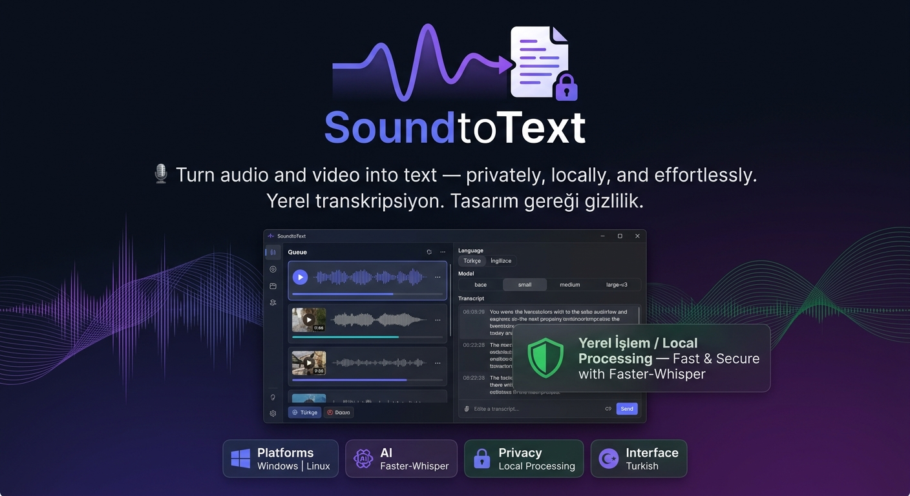

# SoundtoText



<p align="center">
  <strong>🎙️ Turn audio and video into text — privately, locally, and effortlessly.</strong>
  <br />
  <strong>Ses ve videoları gizliliğini koruyarak, yerel olarak ve kolayca metne dönüştür.</strong>
  <br /><br />
  
  
  
  
</p>

<p align="center">
  <a href="#-türkçe">Türkçe</a> ·
  <a href="#-english">English</a> ·
  <a href="#-features">Features</a> ·
  <a href="#-installation">Installation</a> ·
  <a href="#-development--testing">Development</a>
</p>

---

## 🇹🇷 Türkçe

**SoundtoText**, ses ve video dosyalarındaki konuşmaları metne dönüştürmek için geliştirilmiş, Windows ve Linux destekli bir masaüstü uygulamasıdır.

[Faster-Whisper](https://github.com/SYSTRAN/faster-whisper) teknolojisini kullanarak konuşma tanımayı bilgisayarınızda gerçekleştirir. Medya dosyalarınız bir transkripsiyon hizmetine yüklenmez. İlk model indirmesinden sonra, gerekli model dosyaları mevcut olduğu sürece uygulamayı çevrimdışı kullanabilirsiniz.

**Gizliliğinizi koruyun. Dosyalarınızı seçin. Metninizi elde edin.**

Arayüz dilini **Ayarlar → Uygulama dili** bölümünden değiştirebilirsiniz. Bu seçim konuşma tanıma dilinden bağımsızdır ve sonraki açılışlarda korunur.

### ✨ Özellikler

| Özellik | Açıklama |
|---|---|
| 🔒 Yerel işlem | Ses ve video dosyaları bilgisayarınızda işlenir. |
| 🎧 Geniş format desteği | MP3, WAV, M4A, FLAC, MP4, MKV ve daha fazlası. |
| 📂 Çoklu dosya kuyruğu | Birden fazla dosyayı sıraya alıp işleyin. |
| 🌍 Dil seçenekleri | Whisper'ın desteklediği tüm konuşma dilleri ve otomatik algılama. |
| 🌐 İngilizceye çeviri | Konuşmaları İngilizce metne dönüştürün. |
| 📝 Düzenlenebilir sonuçlar | Oluşturulan metni arayın, inceleyin ve düzenleyin. |
| 📤 Çoklu dışa aktarma | TXT, SRT, VTT, JSON ve CSV formatları. |
| 📊 İşlem takibi | İlerleme durumunu ve dosya başına hataları görüntüleyin. |
| 🌐 Çok dilli arayüz | Türkçe, İngilizce, Almanca, Fransızca, İspanyolca, İtalyanca, Portekizce, Rusça ve Arapça arayüz. |
| 🎨 Tema desteği | Koyu ve açık görünüm seçenekleri. |
| ⚙️ Kalıcı ayarlar | Tercihlerinizi sonraki oturumlarda da kullanın. |
| 🖥️ CPU ve CUDA | CPU ile çalışır; uyumlu CUDA aygıtı algılanırsa GPU seçeneği sunulur. |

### 🛡️ Gizlilik ve çevrimdışı kullanım

- Medya dosyaları harici bir transkripsiyon servisine gönderilmez.
- Model dosyaları bilgisayarınızda önbelleğe alınır.
- Video ve ses dosyaları işlenirken geçici, mono 16 kHz WAV dosyası oluşturulur.
- Geçici ses dosyası işlem tamamlandığında silinir.
- Orijinal medya dosyaları değiştirilmez.
- İşlem günlüğüne transkript içeriği yazılmaz.

**Not:** İlk paket ve model indirmeleri internet bağlantısı gerektirir. Model indirildikten sonra ilgili dosyalar yerel olarak mevcutsa transkripsiyon çevrimdışı gerçekleştirilebilir.

### 📦 Desteklenen dosya formatları

**Ses:** MP3, WAV, M4A, AAC, FLAC, OGG, OPUS, WMA

**Video:** MP4, MKV, MOV, AVI, WEBM, M4V

Desteklenen uzantıya sahip dosyaların ayrıca okunabilir ve ses kanalı içeriyor olması gerekir.

### 🚀 Kurulum

#### Gereksinimler

- Windows veya Linux
- Python 3.10–3.14 — önerilen sürüm: Python 3.12
- İlk kurulum ve model indirmesi için internet bağlantısı
- Seçilen model için yeterli disk alanı ve bellek

GPU zorunlu değildir. Uygulama CPU üzerinde de çalışabilir.

#### Windows

1. Proje dosyalarını bilgisayarınıza indirin veya depoyu klonlayın.
2. `install.bat` dosyasını çalıştırın.
3. Kurulum tamamlandıktan sonra `run.bat` dosyasını çalıştırın.
4. Kullanmak istediğiniz modeli seçin ve ilk model indirmesinin tamamlanmasını bekleyin.

#### Linux

Terminali proje klasöründe açın ve aşağıdaki komutları çalıştırın:

```bash
chmod +x install.sh run.sh
./install.sh
./run.sh
```

Linux dağıtımınızda gerekli Qt6 platform bağımlılıkları eksikse, sistem paket yöneticiniz aracılığıyla uygun XCB veya Wayland kütüphanelerini yükleyin.

### 🧠 Model seçenekleri

| Model | Genel kullanım | Kaynak ihtiyacı |
|---|---|---|
| `tiny` | Hızlı, temel transkripsiyon | Çok düşük |
| `base` | Hız ve kaynak kullanımı arasında denge | Düşük |
| `small` | Daha ayrıntılı konuşma tanıma | Orta |
| `medium` | Daha yüksek kaynak bütçesiyle transkripsiyon | Yüksek |
| `large-v3` | Büyük modelle transkripsiyon | Çok yüksek |

Modelin gerçek performansı dile, kayıt kalitesine, donanıma ve konuşmanın özelliklerine göre değişebilir. Daha büyük modeller her durumda kusursuz sonuç garantisi vermez.

**Model önbelleği konumları**

- **Windows:** `%LOCALAPPDATA%\SoundtoText\models\`
- **Linux:** `~/.cache/SoundtoText/models/`

Çevrimdışı ilk kullanım için seçtiğiniz modelin daha önceden indirilmiş olması gerekir.

### 📝 Sonuçları dışa aktarma

Transkripsiyon sonuçlarınızı ihtiyacınıza göre aşağıdaki formatlarda kaydedebilirsiniz:

| Format | Kullanım amacı |
|---|---|
| `.txt` | Düz metin ve notlar |
| `.srt` | Altyazı dosyaları |
| `.vtt` | Web videoları için altyazı |
| `.json` | Yapılandırılmış transkripsiyon verileri |
| `.csv` | Tablo tabanlı inceleme ve işleme |

### 🔧 Sorun giderme

**Model indirilemiyor**

İnternet bağlantınızı ve kullanılabilir disk alanını kontrol edin. Modelin ilk indirilmesi gerekir; daha sonraki çalıştırmalarda yerel önbellek kullanılır.

**Uygulama yavaş çalışıyor veya bellek yetersiz kalıyor**

`tiny` veya `base` gibi daha küçük bir model deneyin. Daha büyük modeller daha fazla bellek ve işlem süresi gerektirir.

**`cublas64_12.dll` bulunamıyor**

Otomatik aygıt seçimi CUDA başlatılamadığında CPU üzerinde `int8` ile yeniden denemeyi destekler. CUDA'yı elle seçtiyseniz `Ayarlar > İşlem aygıtı > Otomatik` seçeneğini kullanın veya uyumlu CUDA 12 NVIDIA çalışma kitaplıklarını kurun.

**Dosya açılamıyor**

Dosyanın desteklenen formatta olduğunu, bozuk veya şifreli olmadığını ve ses kanalı içerdiğini kontrol edin.

**Linux'ta grafik arayüz açılmıyor**

Dağıtımınız için gereken Qt6 platform eklentilerinin, özellikle XCB veya Wayland bağımlılıklarının kurulu olduğundan emin olun.

**Günlük dosyası**

Teknik olaylar `soundtotext.log` dosyasına yazılır. Transkript içeriği bu günlüğe eklenmez.

### 🧪 Geliştirme ve test

Geliştirme bağımlılıklarını kurmak için:

```bash
python -m pip install -r requirements-dev.txt
```

Testleri çalıştırmak için:

```bash
python -m pytest
```

Otomatik testler uzaktaki bir transkripsiyon hizmetini veya model indirmesini kullanmaz.

### 📌 Bilinen sınırlamalar

- Konuşmacı ayrıştırma özelliği mevcut değildir.
- Transkripsiyon doğruluğu kullanılan modele ve kayıt kalitesine bağlıdır.
- PyInstaller ile bağımsız çalıştırılabilir paketleme henüz yapılandırılmamış veya doğrulanmamıştır.
- İlk model indirmesi internet bağlantısı gerektirir.

---

## 🇬🇧 English

**SoundtoText** is a desktop application for Windows and Linux that converts spoken content in audio and video files into text.

Powered by [Faster-Whisper](https://github.com/SYSTRAN/faster-whisper), it performs speech recognition locally on your computer. Your media files are not uploaded to a transcription service. Once the required model files have been downloaded, you can transcribe media offline as long as those files remain available locally.

**Keep your files private. Choose your media. Get your transcript.**

### ✨ Features

| Feature | Description |
|---|---|
| 🔒 Local processing | Audio and video are processed on your computer. |
| 🎧 Multiple media formats | MP3, WAV, M4A, FLAC, MP4, MKV, and more. |
| 📂 Batch queue | Add multiple files to a processing queue. |
| 🌍 Language options | Automatic detection and all languages supported by Whisper. |
| 🌐 Multilingual interface | Turkish, English, German, French, Spanish, Italian, Portuguese, Russian, and Arabic. |
| 🌐 English translation | Translate spoken content into English text. |
| 📝 Editable results | Search, review, and edit generated transcripts. |
| 📤 Multiple export formats | TXT, SRT, VTT, JSON, and CSV. |
| 📊 Progress tracking | Monitor processing progress and file-specific errors. |
| 🎨 Themes | Choose between dark and light appearances. |
| ⚙️ Persistent settings | Keep your preferences between sessions. |
| 🖥️ CPU and CUDA | Runs on the CPU and offers GPU processing when a compatible CUDA device is detected. |

Change the interface language in **Settings → Interface language**. This preference is independent of the speech-recognition language and is remembered between sessions.

### 🛡️ Privacy and offline operation

- Media files are not uploaded to an external transcription service.
- Model files are cached locally on your computer.
- Audio and video are converted into a temporary mono 16 kHz WAV file for processing.
- Temporary audio files are deleted when processing finishes.
- Original media files remain unchanged.
- Transcript content is not written to the application log.

**Note:** An internet connection is required for the initial package and model downloads. Once the required model files are available locally, transcription can run offline.

### 📦 Supported file formats

**Audio:** MP3, WAV, M4A, AAC, FLAC, OGG, OPUS, WMA

**Video:** MP4, MKV, MOV, AVI, WEBM, M4V

Files must use a supported format and contain an accessible audio stream.

### 🚀 Installation

#### Requirements

- Windows or Linux
- Python 3.10–3.14 — Python 3.12 recommended
- Internet access for initial installation and model downloads
- Sufficient disk space and memory for the selected model

A GPU is optional. The application can also run on the CPU.

#### Windows

1. Download the project files or clone the repository.
2. Run `install.bat`.
3. Once installation finishes, run `run.bat`.
4. Select your preferred model and wait for its initial download to complete.

#### Linux

Open a terminal in the project directory and run:

```bash
chmod +x install.sh run.sh
./install.sh
./run.sh
```

If your Linux distribution is missing Qt6 platform dependencies, install the appropriate XCB or Wayland libraries using your system package manager.

### 🧠 Available models

| Model | Typical use | Resource requirements |
|---|---|---|
| `tiny` | Fast, basic transcription | Very low |
| `base` | Balanced speed and resource usage | Low |
| `small` | More detailed speech recognition | Moderate |
| `medium` | Transcription with a larger resource budget | High |
| `large-v3` | Transcription using a large model | Very high |

Actual performance depends on the language, recording quality, hardware, and speech characteristics. Larger models do not guarantee perfect results in every situation.

**Model cache locations**

- **Windows:** `%LOCALAPPDATA%\SoundtoText\models\`
- **Linux:** `~/.cache/SoundtoText/models/`

For your first offline session, make sure the model you intend to use has already been downloaded.

### 📝 Export your transcripts

Save transcription results in the format that best fits your workflow:

| Format | Typical use |
|---|---|
| `.txt` | Plain text and notes |
| `.srt` | Subtitle files |
| `.vtt` | Web video subtitles |
| `.json` | Structured transcription data |
| `.csv` | Tabular review and processing |

### 🔧 Troubleshooting

**The model cannot be downloaded**

Check your internet connection and available disk space. Models must be downloaded before their first use; subsequent runs use the local cache.

**The application is slow or runs out of memory**

Try a smaller model such as `tiny` or `base`. Larger models require more memory and processing time.

**`cublas64_12.dll` is missing**

Automatic device selection supports retrying on the CPU with `int8` if CUDA initialization fails. If you manually selected CUDA, switch to `Settings > Processing device > Automatic` or install compatible CUDA 12 NVIDIA runtime libraries.

**A media file cannot be opened**

Verify that the file uses a supported format, is not corrupted or encrypted, and contains an audio stream.

**The GUI does not open on Linux**

Make sure the Qt6 platform plugins required by your distribution are installed, particularly the XCB or Wayland dependencies.

**Log file**

Technical events are recorded in `soundtotext.log`. Transcript content is not included in the log.

### 🧪 Development and testing

Install the development dependencies:

```bash
python -m pip install -r requirements-dev.txt
```

Run the test suite:

```bash
python -m pytest
```

Automated tests do not use a remote transcription service or download models.

### 📌 Known limitations

- Speaker diarization is not currently available.
- Transcription accuracy depends on the selected model and recording quality.
- Standalone packaging with PyInstaller has not yet been configured or verified.
- An internet connection is required for the initial model download.

---

## 🗂️ Project structure

The following is a suggested layout for organizing the repository's documentation and visual assets. It is not a verified inventory of the current source tree.

```text
SoundtoText/
├── README.md
├── requirements-dev.txt
├── install.bat
├── run.bat
├── install.sh
├── run.sh
└── docs/
    └── assets/
        ├── banner.png
        ├── screenshot-main.png
        └── screenshot-results.png
```

## 🎨 Visual design recommendations

For a polished GitHub project page, consider the following visual style:

- **Primary color:** Indigo `#6478FF`
- **Accent color:** Violet `#8B5CF6`
- **Success color:** Green `#16A34A`
- **Background:** White or near-black, depending on the viewer's theme
- **Typography:** GitHub's native system font stack for consistent rendering
- **Logo:** A simple waveform combined with a text/document symbol
- **Screenshots:** The actual application window, a completed transcript, and the export options

GitHub README files do not reliably support custom fonts through embedded CSS. Use GitHub's native typography and create branded visuals as image assets instead.

Once you have real screenshots, add them below the project introduction using their actual repository paths. Avoid committing screenshots that expose private audio, personal information, or sensitive transcripts.

---

<p align="center">
  <strong>SoundtoText</strong>
  <br />
  Local transcription. Private by design.
  <br />
  Yerel transkripsiyon. Tasarım gereği gizlilik.
</p>
